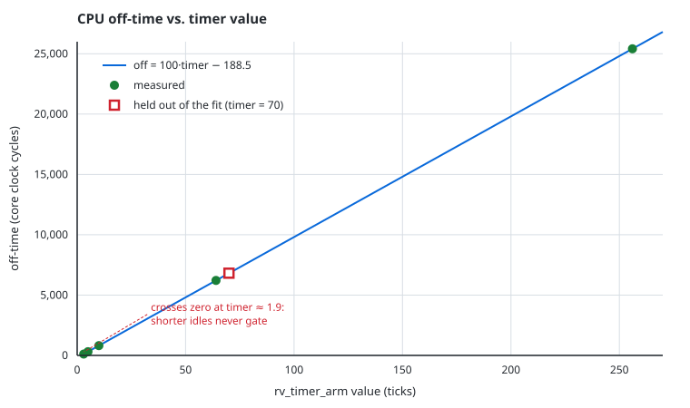

# Characterising CPU power-gating timing in X-HEEP

An RTL-measurement experiment on [X-HEEP](https://github.com/esl-epfl/x-heep),
run in Verilator on a laptop.

**TL;DR**

- Built X-HEEP in Verilator, swept the emulated wake-up delay and the idle
  length in `example_power_manager`, and measured the CPU power-domain
  transitions directly from the simulation waveforms.
- Wake latency is `delta + 5` cycles; off-time is `100·timer − 188.5` cycles.
  Max error 0.5 cycles over an 85× range in idle length, with one point held
  out of the fit and predicted correctly.
- The fixed ~188-cycle sequencing overhead puts a **floor** on how short an
  idle period can usefully be gated — at the paper's 1 MHz operating point
  that floor is about **190 µs**, not microseconds.
- Using the paper's 24 µW (a conservative, phase-averaged figure), break-even
  wake-up energy ranges from **2.7 nJ to 610 nJ** depending on idle length.
  The paper does not report E_wake, so this is the half of the comparison that
  cannot be closed from it.



## Motivation

The X-HEEP paper reports the *benefit* of power-gating the idle CPU subsystem,
but not the *cost* of waking the domain back up.

The benefit figures are in [arXiv:2401.05548](https://arxiv.org/abs/2401.05548),
§4.3.1 (acquisition phase, 1 MHz, 0.8 V) — in the running text, not in any
table or figure:

| configuration | power |
|---|---|
| complete system active, host CPU clock-gated when unused | 384 µW |
| + unused memory banks, peripheral domain and external accelerators off | 310 µW (−19 %) |
| + CPU turned off during idle periods | **286 µW** (−8 %) |

So ΔP = 310 − 286 = **24 µW**.

Gating only pays for itself when

```
ΔP · T_off  >  E_wake        ⟺        T_off  >  T_be = E_wake / ΔP
```

The reference application is explicit that the cost side is unmodelled. In
`sw/applications/example_power_manager/main.c`:

```c
reset_on = switch_on + 20; // give 20 cycles to emulate the turn on time,
                           // this number depends on technology and here it
                           // is just a random number
```

So this experiment answers the half that *is* measurable from RTL: how long is
the CPU actually off, and how long does it take to come back? E_wake is swept
as a parameter — see "Limitations".

## Method

Two knobs in `example_power_manager/main.c` were swept:

| knob | site | meaning |
|---|---|---|
| `reset_on = switch_on + N` | 1 site | emulated turn-on cost ("wake delta") |
| `rv_timer_arm(..., N)` | 4 sites | idle length |

For each point: rebuild the firmware, run the Verilator model, and measure the
power-domain transitions from the FST waveform.

`measure_pg.py` matches these signals by name, at whatever hierarchy level they
appear in the trace (the testbench instantiates the DUT as `testharness_i`):

- `off_cycles` — `cpu_subsystem_powergate_switch_no` low → high (domain truly off)
- `wake_cycles` — switch-on → `cpu_subsystem_powergate_iso_n` release (full recovery)

Both are active low (`core_v_mini_mcu.sv:410,413`). Each point averages the
four timer-driven gating episodes, which run before the DMA and GPIO wake
tests — see "Details".

Scripts: `measure_pg.py` (waveform → cycle counts), `sweep_pg.py` (sweep
driver), `breakeven.py` (analysis), `make_plot.py` (figure).

## Results

`sweep_results_all.csv`:

| wake_delta | timer | off (cyc) | sd | wake (cyc) |
|---:|---:|---:|---:|---:|
| 20 | 3 | 111.2 | 0.8 | 25.0 |
| 20 | 5 | 311.2 | 0.8 | 25.0 |
| 20 | 64 | 6211.5 | 0.9 | 25.0 |
| 20 | 256 | 25411.5 | 0.9 | 25.0 |
| 100 | 64 | 6210.8 | 0.4 | 105.0 |
| 1000 | 64 | 6210.8 | 0.4 | 1005.0 |

The two knobs are **orthogonal**, and both relationships are exact:

```
wake = delta + 5          (independent of idle length)
off  = 100·timer − 188.5  (independent of wake delta)
```

**`wake = delta + 5`** is not a fit — it is `iso_on − switch_on` read straight
off the counter setup (`switch_on = 10; reset_on = switch_on + delta;
iso_on = reset_on + 5`). Measured exactly at delta = 20, 100, 1000.

**`off = 100·timer − 188.5`** was fitted on timer = 64 and 256, then tested:

| timer | model | measured | err | provenance |
|---:|---:|---:|---:|---|
| 3 | 111.5 | 111.2 | −0.3 | measured after fitting |
| 5 | 311.5 | 311.2 | −0.3 | measured after fitting |
| 10 | 811.5 | 811.2 | −0.3 | measured after fitting (see note) |
| 64 | 6211.5 | 6211.5 | +0.0 | used in fit |
| 70 | 6811.5 | 6812.0 | +0.5 | **held out** — unmodified upstream run, not used in fit |
| 256 | 25411.5 | 25411.5 | +0.0 | used in fit |

The `timer = 10` run was interrupted after the timer phase, so it is absent
from `sweep_results_all.csv`, which only records runs that completed every
test. Its four timer episodes (810, 812, 811, 812) had already been traced and
are reported here as an additional check.

The `timer = 70` row needs a caveat: it comes from the **unmodified** upstream
application, where the four sites are not equal — two are armed at 64 and two
at 70. So it is a 2-episode average, not 4 like the swept points. It is still a
genuine out-of-sample test, but a weaker measurement than the others.

Both coefficients are verifiable from the source rather than inferred from the
fit:

- **slope = 100.0 exactly** — the timer tick divider. `main.c:44` sets
  `kTickFreqHz = 1 MHz` and `sw/device/target/sim/x-heep.h:15` sets
  `REFERENCE_CLOCK_Hz = 100 MHz`, giving exactly 100 core cycles per tick.
- **intercept = −188.5** — fixed sequencing overhead. The domain is *not* off
  for the whole nominal window: the shutdown sequence (`iso_off = 10`,
  `reset_off = 15`, `switch_off = 20`) and the wake/ISR path consume cycles at
  each end.

### Consequences

**1. A slower wake-up buys no extra time off.** Raising the wake delta 50×
(20 → 1000 cycles) left off-time unchanged at ~6211 cycles. This is a property
of how this power manager is arranged, not a general law: the timer defines the
off window, and the wake delay is added *after* it. So a slower wake-up adds
overhead without adding time spent off.

**2. There is a hard floor on gateable idle.** `off > 0` requires
`timer ≥ 2` at the simulated clock. Below that, the 188.5-cycle sequencing
overhead exceeds the window and the domain never reaches off at all. How long
that floor is in real time depends strongly on the clock — see below.

### Break-even

Rescaling measured cycle counts to 1 MHz, the operating point ΔP was measured
at, and taking ΔP = 24 µW:

| timer | T_off | break-even E_wake |
|---:|---:|---:|
| 3 | 111 µs | **2.7 nJ** |
| 5 | 311 µs | 7.5 nJ |
| 64 | 6.21 ms | 149 nJ |
| 256 | 25.4 ms | 610 nJ |

Break-even moves by two orders of magnitude across the measured idle range, so
there is no single answer to "is gating worth it?" for this design. It depends
on the idle length, and at short idles it depends on E_wake at a resolution the
paper does not provide.

Whether 149 nJ is comfortably above a real CPU-domain wake-up energy is not
something this experiment can settle: that depends on domain capacitance and
the technology node, neither of which is modelled here. What holds is the
conditional — gating pays iff E_wake < ΔP·T_off — and this work supplies T_off
exactly while E_wake remains unreported upstream.

### Why these figures are conservative

ΔP = 24 µW is **not** the CPU domain's idle-but-powered power minus its
powered-off power. It is an average saving over the whole acquisition phase,
and three things are folded into it:

1. The CPU is not idle the whole time — it wakes to read ADC samples, so the
   saving only accrues during the idle fraction.
2. Wake-up overheads are already inside the 286 µW average.
3. The 310 µW baseline **already clock-gates** the idle CPU. So 24 µW is the
   marginal benefit of power-gating *on top of* clock-gating — roughly what
   clock-gating leaves behind, which is mostly leakage.

The instantaneous saving during an idle period is therefore at least 24 µW and
probably more. Since T_be = E_wake / ΔP, using 24 µW *overestimates* break-even
time, and using it in E_crit = ΔP·T_off *underestimates* the tolerable wake-up
energy. Both figures above are conservative bounds: real gating would pay off
at least this early, not later.

### What the overhead costs at 1 MHz

The rescaling above needs care, and this is where the headline floor changes.

The measurements were taken at 100 MHz, where the timer divider is 100 core
cycles per tick. Cycle counts are clock-independent, so converting them to a
duration at 1 MHz is arithmetic. But the *divider is not* clock-independent:
`rv_timer_approximate_tick_params` derives it from the core frequency, so a
real system clocked at 1 MHz with a 1 MHz tick gets **1 cycle per tick**, not
100. Idle lengths there are set in real time, not in units of 100 cycles.

That makes the fixed overhead far more significant:

| | 188.5 cycles is | minimum gateable idle |
|---|---|---|
| simulation, 100 MHz | 1.89 µs | ~1.9 µs |
| paper's operating point, 1 MHz | **188.5 µs** | **~190 µs** |

So at 1 MHz an idle period shorter than roughly 190 µs cannot be usefully
power-gated at all — the sequencing overhead consumes it. That is a much
stricter limit than the simulated figure suggests, and it bounds the regime
where the break-even question is even worth asking.

## Limitations

- **E_wake is not measurable here.** Verilator is cycle-accurate, not analog:
  it yields cycles, never joules. E_wake is swept as a parameter, and it is
  also precisely the quantity the paper leaves unreported.
- **Clock-rate mismatch.** The testbench runs at 100 MHz
  (`tb/tb_top.sv:16`, `CLK_FREQUENCY_KHz = 100_000`); ΔP is quoted at 1 MHz,
  0.8 V. Cycle counts rescale legitimately, but pairing these timings with ΔP
  at 100 MHz would not — the leakage/dynamic balance shifts with frequency and
  voltage. See "What the overhead costs at 1 MHz".
- **ΔP is taken from the paper, not independently reproduced.** It is also a
  phase average rather than an instantaneous domain delta, measured against an
  already-clock-gated baseline. Reproducing it would need gate-level power
  analysis, which RTL simulation cannot provide.
- **The `timer = 2` floor is extrapolated**, not measured. The measured range
  is timer = 3 … 256.
- **Turn-on time is emulated, not physical.** The 20-cycle delay is upstream's
  placeholder, so `wake = delta + 5` characterises the power manager's
  sequencing, not any real technology's settling time.

## How this was done

The builds, simulations and sweeps were run on my own machine; I chose what to
sweep, read the power manager and timer source to work out what the fitted
coefficients meant, checked the figures against §4.3.1 of the paper, and
interpreted the results — including the point above about the tick divider not
transferring across clock rates.

I used an AI assistant (Claude) for scripting and for drafting this write-up.
Several of its intermediate claims were wrong and were corrected against the
source — among them an incorrect wake formula, a non-existent `make` target, a
hierarchy path that does not exist in the testbench, and a waveform parser that
asked for a signal name absent from the RTL. The commit history records those
corrections. Every number reported here comes from a measurement I ran, and I
can explain each script and each figure.

## Reproducing

```
OS         Ubuntu 24.04.4 LTS, 4 cores
commit     b3eb3c8d626d3debe8e5cf99ecff32a5a31549fd
Verilator  5.040 2025-08-30
compiler   riscv32-corev-elf-gcc (corev-openhw-gcc-ubuntu2004-20240530) 14.1.0
```

`sweep_pg.py` and `measure_pg.py` locate the tree relative to their own
location, so they must be run **from the x-heep root**:

```sh
cd /path/to/x-heep
cp /path/to/this-repo/{sweep_pg.py,measure_pg.py,breakeven.py} .
git apply /path/to/this-repo/printf-in-sim.patch

export RISCV_XHEEP=$HOME/tools/riscv   # without this, the Makefile derives
                                       # COMPILER_PREFIX from the host gcc
export PATH=$HOME/tools/verilator/5.040/bin:$RISCV_XHEEP/bin:$PATH
source .venv/bin/activate

make mcu-gen MEMORY_BANKS=4   # MEMORY_BANKS is an mcu-gen parameter
make verilator-build          # ~43 min on 4 cores; one-off

python3 sweep_pg.py           # ~15 min for all six points
python3 breakeven.py
python3 make_plot.py
```

Roughly an hour end to end, dominated by the one-off model build. Within the
sweep, cost grows with the timer value: `timer = 64` simulates in about 90 s,
`timer = 256` takes 8 min 45 s.

`fst2vcd` (from gtkwave) must be on `PATH` — `measure_pg.py` shells out to it.

`sweep_pg.py` keeps a pristine copy of `main.c` and restores it after every
run. The only persistent change to the upstream tree is
`#define PRINTF_IN_SIM 1`, so UART output is visible in simulation; that one
line is `printf-in-sim.patch` in this repo.

## Details

A full trace contains 7 gating episodes, not 4, which is why `measure_pg.py`
takes the first four:

| # | off (cyc) | what |
|---:|---:|---|
| 1 | 0.5 | reset artifact at t=0, dropped by an `off < 1` filter |
| 2–5 | 810–812 | the four timer-driven episodes (this is `timer = 10`) |
| 6 | 606.0 | DMA wake test |
| 7 | 1860.0 | GPIO wake test |

The timer tests sit at `main.c` lines 129–171, before the DMA test at 189 and
the GPIO test at 257. Running `measure_pg.py` on a waveform prints every
episode, so this can be checked directly rather than taken on trust.

The `episodes` column in the CSV is capped at 4 by construction and is a sanity
check, not a count of all gating events in a run.
